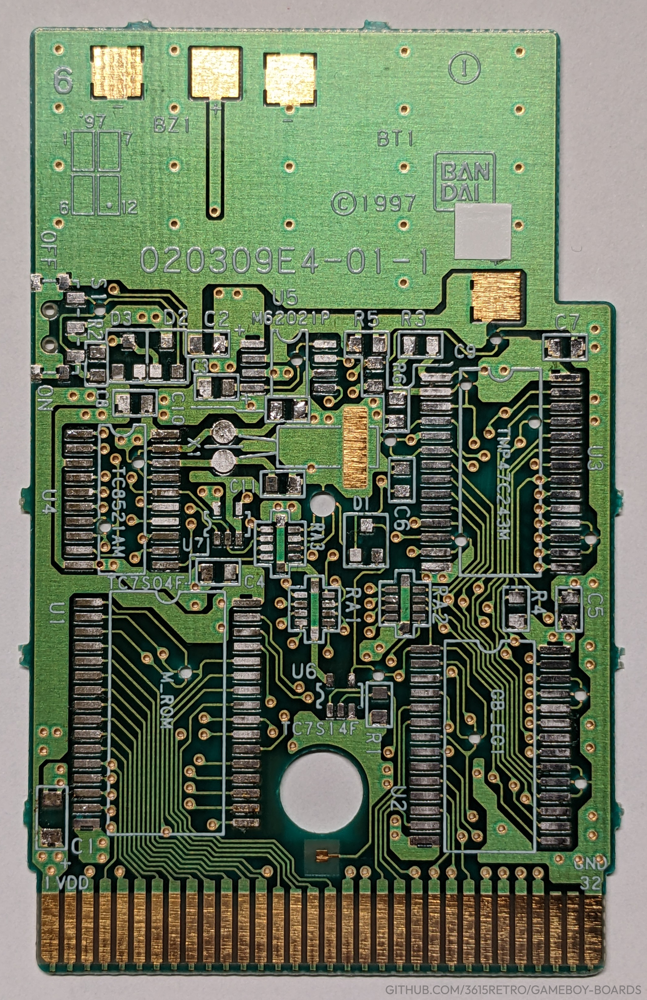
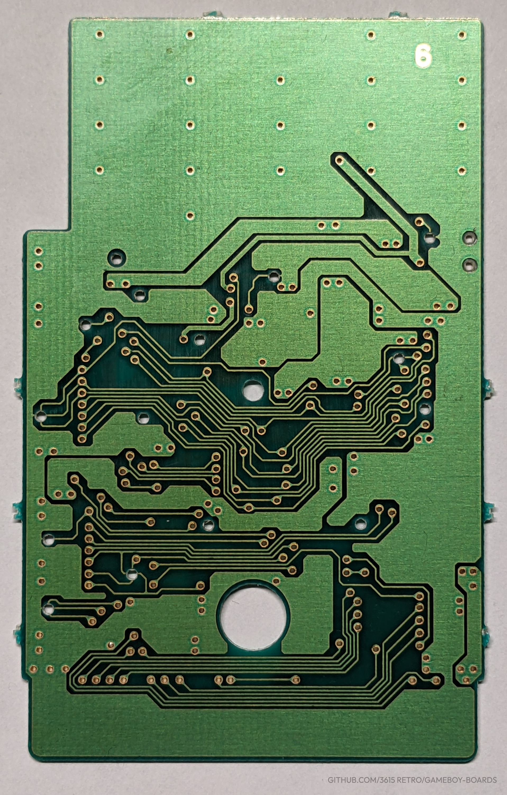

  
  

# 020309E4-01-1

## Known games using the board :  
DMG-AOMJ-JPN : Game de Hakken!! Tamagotchi - Osutchi to Mesutchi

See more on : https://gbhwdb.gekkio.fi/cartridges/020309E4.html

## Values of component :
R1   : 1 k Ω  
R2   : 1 k Ω  
R3   : 4,7 k Ω  
R4   : 4,7 k Ω  
R5   : 100 Ω  
R6   :  100 Ω  
RA 1 : 93 k Ω  
RA 2 : 93 k Ω  
RA 3 : 93 k Ω  

## Chip height (legless / casing)
U1 - TAMA 7 : 2.8 mm  
U2 - TAMA 5 : 2.7 mm  
U3 - TAMA 6 : 2.4 mm  