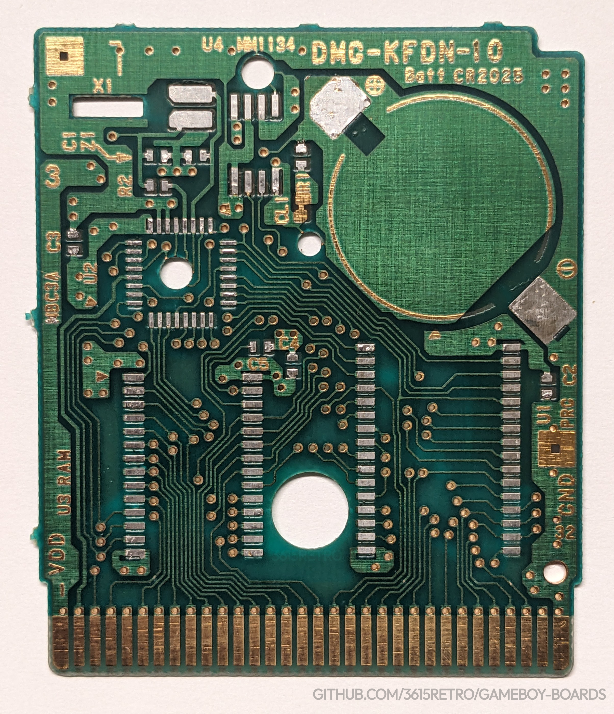
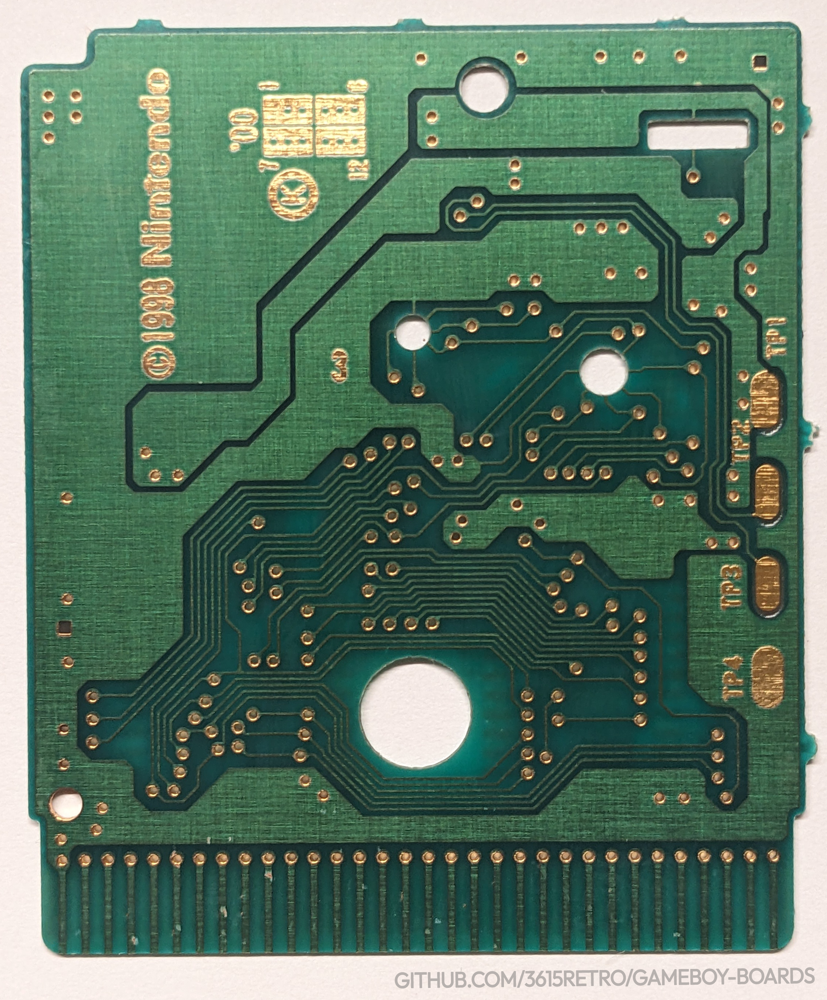

  
  

# DMG-KFDN-10

## Known games using the board : 
DMG-AOMJ-JPN   : Pocket Monsters - Pikachu (Japan) (Rev 2)
DMG-AOMJ-JPN   : Pocket Monsters - Pikachu (Japan) (Rev 3)

DMG-APEE-USA   : Pokemon - Blue Version (USA)
DMG-APEE-USA-1 : Pokemon - Blue Version (USA)
DMG-APAE-USA   : Pokemon - Red Version (USA)
DMG-APAE-USA-1 : Pokemon - Red Version (USA)
DMG-APEU-EUR   : Pokemon - Blue Version (Europe)
DMG-APAU-EUR   : Pokemon - Red Version (Europe)
DMG-AAXJ-JPN   : Pocket Monsters Gin (Japan)
DMG-AAUJ-JPN   : Pocket Monsters Kin (Japan) (Rev 1)
CGB-BHTJ-JPN   : Tottoko Hamutarou - Tomodachi Daisakusen Dechu (Japan) (Rev 1)
DMG-ABEJ-JPN-1 : Barcode Taisen Bardigun (Japan) (Rev 1)

See more on : https://gbhwdb.gekkio.fi/cartridges/DMG-KFDN.html

## Values of component :
R1   : 1 k Ω  
Z1   : 0,2 Ω  
